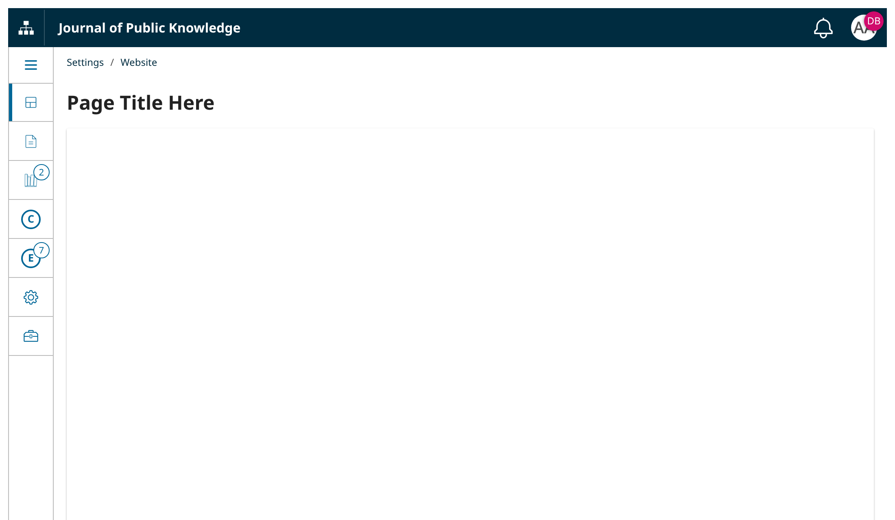
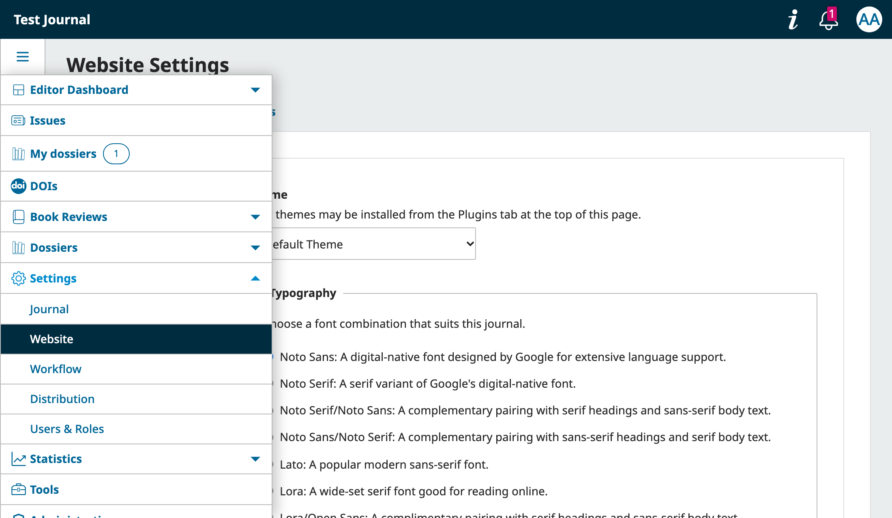

# Collapsible Dashboard Menu for OJS 3.5

An OJS plugin that **collapses the left menu of the editorial backend to its icons**, so that the dashboards, the workflow and the settings have more room on smaller screens. A click on an icon opens the menu as a **drawer over the page**, which closes again afterwards. Counts in the menu's names, such as `My dossiers (2)`, become **badges** on the icons.

| Collapsed, mouse over the *My dossiers* icon | Drawer open (after a click on the Settings icon) |
| --- | --- |
|  |  |

The screenshots show an OJS 3.5 test journal with [Dossier Manager](https://github.com/cboulanger/ojs-dossier-manager) and [Book Review Manager](https://github.com/cboulanger/ojs-book-review-manager) installed; *My dossiers (1)* is a menu entry with a count from another plugin, shown as a badge.

## What it does

- **Collapsed menu.** The menu (about 21rem wide) becomes a column of icons (3.5rem). Hovering an icon shows the entry's name (with its count, if any) in a tooltip beside the menu. Entries without an icon, or with an icon OJS doesn't know, show the first letter of their name in a circle. The icon of the section that contains the current page is marked with a bar.
- **Drawer.** A click on an icon with a submenu (Dashboards, Settings, Statistics, …) opens the whole menu over the page, with that section expanded. The page doesn't move or reflow. Icons with a direct link (e.g. Tools, Announcements) just follow the link.
- **Recollapsing.** The drawer closes when a link in it is chosen (also when the dashboards only change the view without loading a new page), shortly after the mouse leaves it, on a click or tap outside, or with Escape.
- **Badges.** A count in parentheses at the end of a menu entry's name (`Name (12)`) is removed from the name and shown as a badge instead, at every level of the menu. In the open menu, all badges (also OJS's own) are shown after the name (OJS puts them before the icon or name); in the collapsed menu they sit on the icon's corner. Entries that already have a badge (such as the dashboard views, whose counts OJS loads itself) are left as they are. This is done on the server, before the page is drawn, so it works for the entries of any plugin (e.g. *My dossiers (2)* and *My dossier contributions (1)* from [Dossier Manager](https://github.com/cboulanger/ojs-dossier-manager)).
- **Keep open.** The button at the top of the menu switches back to the full menu, as without the plugin, and back again. The choice is stored in the browser (`localStorage`), per user and device.
- **Keyboard and screen readers.** The drawer opens when the keyboard focus enters the menu and closes when it leaves; Escape closes it and returns to the icon. The names stay in the page for screen readers, only hidden from view.
- Right-to-left languages: the menu opens from the right.
- **Phones with Mobile Dashboard.** If [Mobile Dashboard](https://github.com/SNatangelo/ojs-mobile-dashboard) is enabled, this plugin leaves the menu to it on screens 900px wide or narrower (see below).

No database tables, no settings, nothing stored on the server. English and German.

## How it works

OJS 3.5 draws the menu in the browser with Vue (the ui-library's `SideNav`, a PrimeVue `PanelMenu`) from the page's `menu` state. The plugin doesn't replace that menu:

- On the server, `DashboardCollapsePlugin` hooks into `TemplateManager::display` as the last plugin, after OJS and other plugins have added their entries, and moves the counts into badges in the `menu` state ([`classes/MenuBadges.php`](classes/MenuBadges.php)). It adds the script and the styles to backend pages that have the menu.
- In the browser, [`js/dashboardCollapse.js`](js/dashboardCollapse.js) sets classes on `<html>` for the states (collapsed, open, kept open), adds the tooltips, first letters, the current-section mark and the toggle button, and opens and closes the drawer. [`css/dashboardCollapse.css`](css/dashboardCollapse.css) does the layout. The parts of the menu are found by PrimeVue's `data-pc-section` attributes and the structure of OJS's `SideMenu`, so a future OJS version that changes the menu may need an update of the plugin.

## Mobile Dashboard

[Mobile Dashboard](https://github.com/SNatangelo/ojs-mobile-dashboard) makes the backend usable on phones and turns the menu into its own ☰ drawer at widths of 900px or less. Both plugins together on a phone gave two menus in one, with entries that could not be tapped ([forum thread](https://forum.pkp.sfu.ca/t/new-plugin-mobile-friendly-editorial-dashboard-for-ojs-3-5/99115)). So when Mobile Dashboard is on the page and the screen is 900px wide or narrower, this plugin steps aside: the menu is exactly as Mobile Dashboard makes it, without the icon column, the toggle button or the tooltips. On wider screens it works as usual. Turning a tablet or resizing the window across 900px switches without a reload, and the *Keep open* choice is kept. Badges stay, in OJS's own place before the name.

There is no setting. The script recognises Mobile Dashboard by its files in the page (`/mobileDashboard/styles/mobile.css` or `.js`), or by the button, backdrop and attribute it adds (`#mdNavToggle`, `#mdNavBackdrop`, `#app-nav[data-md-ready]`). These heuristics and the 900px width are at the top of [`js/dashboardCollapse.js`](js/dashboardCollapse.js) (`MOBILE_DASHBOARD_QUERY`, `MOBILE_DASHBOARD_MARKERS`), to be updated if Mobile Dashboard changes. Without Mobile Dashboard nothing changes at any width.

## Installation

Requirements: OJS 3.5, PHP 8.2 or later.

```sh
cd /path/to/ojs/plugins/generic
git clone https://github.com/cboulanger/ojs-dashboard-collapse.git dashboardCollapse   # the folder name matters
cd /path/to/ojs
php lib/pkp/tools/installPluginVersion.php plugins/generic/dashboardCollapse/version.xml
```

Then enable *Collapsible Dashboard Menu* under *Website Settings › Plugins › Generic Plugins*, in each journal where it should apply.

## Files

| Path | Contents |
| --- | --- |
| `DashboardCollapsePlugin.php` | Moves the counts into badges and adds the script, styles and texts to the backend pages |
| `classes/MenuBadges.php` | Moving the counts into badges (no OJS classes, tested on its own) |
| `js/dashboardCollapse.js` | States, drawer, tooltips, first letters, toggle button |
| `css/dashboardCollapse.css` | Collapsed menu, drawer, badges on the icons |

## Tests

`php dev/test/menuBadges.test.php` tests the moving of counts into badges (no OJS needed). The script and styles were tested in Chromium against OJS 3.5's own menu component (the ui-library's `SideNav` at `stable-3_5_0`, in its Storybook page story): collapsing, opening by click and keyboard, closing by link, mouse leave, outside click and Escape, badges, first letters, keeping open, and a phone-sized window.

`dev/test/mobileDashboard.browser.mjs` tests the plugin together with Mobile Dashboard in the same Storybook page (setup in the file's header; not run by CI): suspended at 390px and 900px with all menu entries tappable in Mobile Dashboard's drawer, active at 901px, no flash of the icon column when a page loads on a phone, resizing across 900px with the drawer open and with the menu kept open, detection by the DOM markers alone, and no change without Mobile Dashboard.

## Releases

The release package contains only what OJS needs (a rule of the PKP Plugin Gallery). What is left out is marked `export-ignore` in [`.gitattributes`](.gitattributes): `dev/` and the repository files.

1. Set `<release>` (four numbers) and `<date>` in `version.xml` and commit.
2. Optional: check the package locally with `dev/package.sh` (writes `dist/`). It fails if the package lacks a runtime file or contains development files.
3. Push an annotated tag matching the version (`0.1.0.0` → `v0.1.0`, `0.1.0.2` → `v0.1.0-2`). Its first line becomes the release description in the gallery:

   ```sh
   git tag -a v0.1.0 -m "What changed, in one line" && git push origin v0.1.0
   ```

4. The [Release workflow](.github/workflows/release.yml) runs the checks ([CI](.github/workflows/ci.yml)), builds the package and creates a **draft** release with `dashboardCollapse-v0.1.0.tar.gz`, its `.md5`, `gallery-release.xml` and `gallery-plugin.xml`. Test the package, then publish the draft on GitHub.
5. Plugin Gallery: open a pull request on [pkp/plugin-gallery](https://github.com/pkp/plugin-gallery) that adds `gallery-release.xml` to the plugin's entry in `plugins.xml` (the first time: `gallery-plugin.xml`, the whole entry). Disclose AI-assisted work in the pull request.

The gallery entry's texts are in [`dev/gallery/plugin.xml`](dev/gallery/plugin.xml) and [`dev/gallery/description.html`](dev/gallery/description.html).

## License

GNU General Public License v3. See [LICENSE](LICENSE).
